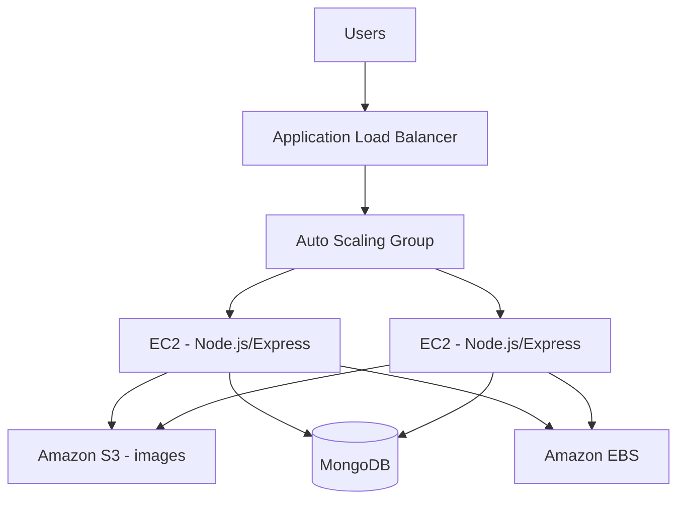

# EventHub — AWS Architecture (ap-south-1, Mumbai)

## Diagram

```
Users (browser)
  |
Internet
  |
Application Load Balancer (ALB, public subnets, port 80/443)
  |
Auto Scaling Group (min 1, desired 1, max 2 — t2.micro/t3.micro)
  |            |
EC2 #1       EC2 #2        (Ubuntu, Node 20, PM2, Nginx)
  |            |
Node.js / Express backend (port 5000, behind Nginx on port 80)
  |                |
  |                +-- Amazon S3 (event images, via IAM role — no keys)
  |                +-- MongoDB (Atlas / EC2-hosted; in-memory fallback locally)
  |
Amazon EBS (8 GB gp3, persistent root + app data volume, /data)
```

Supporting infrastructure: **VPC** (`10.0.0.0/16`) with 2 public subnets (for ALB + EC2 in this student setup) and 2 private subnets (reserved for a future database tier), **Internet Gateway**, route tables (`0.0.0.0/0 → IGW` for public subnets), **Security Groups** (ALB: 80/443 from `0.0.0.0/0`; EC2: 80/443 from ALB SG only, 22 from your IP only), and **IAM** (EC2 instance role with least-privilege S3 access only).



## Data flow

1. User opens the ALB DNS name → ALB health-checks (`GET /api/health`) the target group.
2. ALB forwards HTTP to a healthy EC2 instance in the Auto Scaling Group.
3. Nginx (port 80) serves the React production build and proxies `/api` and `/uploads` to Node.js on port 5000 (managed by PM2).
4. Backend reads/writes events, users and bookings in MongoDB; image uploads go to S3 via the EC2 IAM role (SDK v3, `src/utils/s3.js`); without S3 configured it stores locally under `backend/uploads/`.
5. EBS persists the OS, app code and uploads on each instance.
6. If CPU/load rises, the ASG launches another instance from the Launch Template; if an instance fails its health check, the ASG replaces it.

## The 7 mandatory AWS services

| # | Service | How EventHub uses it |
| --- | --- | --- |
| 1 | EC2 | Ubuntu instances running Node.js + Nginx + PM2 |
| 2 | S3 | Event images / documents; private bucket, access via IAM role |
| 3 | IAM | EC2 instance role + least-privilege policy (`aws/iam-role-policy.json`) |
| 4 | EBS | 8 GB gp3 root volume + mounted data volume (`/data`) |
| 5 | VPC | Dedicated VPC, public/private subnets, IGW, route tables, security groups |
| 6 | ELB (ALB) | Public entry point, target group, `/api/health` health checks |
| 7 | Auto Scaling | Launch Template + ASG (min 1 / desired 1 / max 2) + CPU scaling policy |
